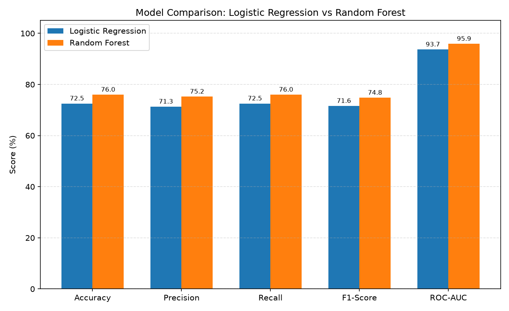

# Model Comparison Report

| Metric | Logistic Regression | Random Forest |
|---|---|---|
| Accuracy | 72.54% | 76.00% |
| Precision | 71.32% | 75.23% |
| Recall | 72.54% | 76.00% |
| F1-Score | 71.59% | 74.80% |
| ROC-AUC | 93.67% | 95.88% |

## Overfitting Check (train accuracy - test accuracy)

- **Logistic Regression**: -0.09 points
- **Random Forest**: +0.27 points

## Best Model: **Random Forest** (highest F1-score)
